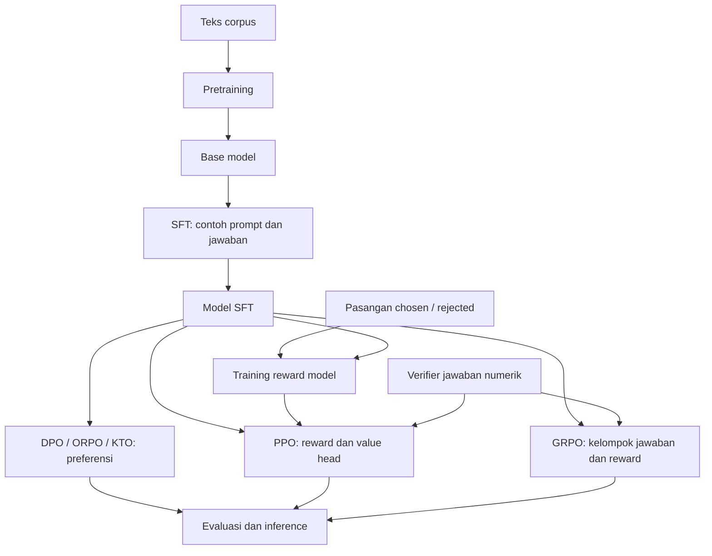

# Memahami LLM melalui kode, untuk pembaca berlatar matematika

Tanggal: 29 September 2026. Panduan ini membaca kode lokal dengan pendekatan AntiVibe: apa yang dihitung, mengapa operasi itu diperlukan, kapan dipakai, dan apa alternatifnya. Bahasa mengikuti antislop-copywriting.

LLM di proyek ini adalah fungsi berparameter yang mengubah urutan token menjadi distribusi peluang token berikutnya. Training mencari parameter fungsi itu. SFT, DPO, PPO, dan GRPO mengubah data atau tujuan optimisasinya, sementara sebagian besar jaringan tetap sama.

$$
f_\theta:\{0,\ldots,V-1\}^{B\times T}\longrightarrow\mathbb R^{B\times T\times V},
\qquad p_\theta(x_{t+1}\mid x_{\le t})=\operatorname{softmax}(f_\theta(x)_{t,:}).
$$

Di sini $\theta$ adalah seluruh bobot yang dipelajari, $V$ ukuran kosakata, $B$ banyak urutan dalam satu batch, dan $T$ panjang urutan. Keluaran $f_\theta$ masih berupa skor real, disebut *logits*. Softmax mengubahnya menjadi peluang.

## Urutan baca

| Bab | Yang ingin Anda pahami | Bacaan |
|---|---|---|
| 1 | Menghubungkan probabilitas dan aljabar linear dengan Python | [Dasar dan notasi](llm-matematika-2026-09-29/01-dasar.md) |
| 2 | Mengikuti perubahan teks menjadi pasangan input dan target | [Data dan token](llm-matematika-2026-09-29/02-data.md) |
| 3 | Mengikuti satu forward pass, lengkap dengan ukuran matriks | [Transformer](llm-matematika-2026-09-29/03-transformer.md) |
| 4 | Mengerti bagaimana bobot berubah dan teks dihasilkan | [Training dan generation](llm-matematika-2026-09-29/04-training.md) |
| 5 | Mengerti SFT, reward model, DPO, ORPO, dan KTO | [Belajar dari contoh dan preferensi](llm-matematika-2026-09-29/05-sft-preferensi.md) |
| 6 | Menghubungkan reinforcement learning dengan prediksi token | [PPO dan GRPO](llm-matematika-2026-09-29/06-rl.md) |
| 7 | Membaca konfigurasi, evaluasi, dan keterbatasan implementasi | [Membaca hasil dengan tepat](llm-matematika-2026-09-29/07-praktik.md) |
| 8 | Mencari singkatan dan sumber lanjutan | [Glosarium dan referensi](llm-matematika-2026-09-29/08-glosarium.md) |
| Lampiran | Mencari setiap deklarasi pada berkas pipeline | [Kamus fungsi dan variabel](llm-matematika-2026-09-29/kamus/README.md) |

Baca bab secara berurutan. Buka kamus ketika menemukan nama yang belum jelas; kamus panjang karena berfungsi sebagai referensi, bukan bacaan sekali duduk. Setiap bab memiliki latihan kecil beserta jawaban agar Anda bisa mengecek pemahaman tanpa melatih model besar.

## Hubungan antar tahap

DPO, PPO, dan GRPO tidak wajib dijalankan sebagai satu rantai. Pada konfigurasi standar lokal, masing-masing memuat `sft_ckpt`. Perintah yang menjalankan semuanya secara berurutan tidak otomatis berarti checkpoint tahap sebelumnya menjadi input tahap berikutnya.

## Cakupan dan cara memeriksa penjelasan

Sumber utama penjelasan adalah implementasi lokal dalam `src/models/`, `src/post_training/` beserta `rewards/`, `data_loader/`, `config/`, dan skrip Python dalam `scripts/`. Kamus mencatat parameter fungsi, variabel lokal, atribut objek yang dideklarasikan, konstanta, serta fungsi dan kelas pada berkas tersebut. Nama yang sama diberi konteks lingkup, karena `x`, `mask`, atau `C` dapat berarti hal berbeda. Alias impor adalah nama pustaka, bukan parameter model; dasarnya dijelaskan pada bab 1.

Folder `ui/` mengatur antarmuka Streamlit; `images/` membuat gambar; `tests/` memeriksa perilaku. Ketiganya bukan jalur perhitungan LLM yang dibedah dalam kamus ini. Eksperimen sparse dan notebook mempunyai bacaan lokal terpisah: [dense dan sparse](notebook-dense-sparse-2026-09-27.md), [evolutionary sparse training](evolutionary-sparse-training-2026-09-23.md), dan [daftar notebook](../notebook/README.md).

Referensi penulis memberi susunan materi pretraining sampai post-training. Panduan ini menambahkan penjelasan Indonesia dan membandingkannya dengan kode lokal, yang dapat berbeda dari situs. [Dokumentasi Fareed Khan](https://fareedkhan-dev.github.io/train-llm-from-scratch/).

Angka pada contoh hitung ditandai sebagai ilustrasi. Angka konfigurasi berasal dari berkas proyek. Panduan ini tidak melaporkan hasil training baru.

[Catatan pemeriksaan](llm-matematika-2026-09-29/pemeriksaan.md) mencatat cakupan kamus, pemeriksaan tautan, dan contoh matematika yang telah dicocokkan dengan kode CPU.
